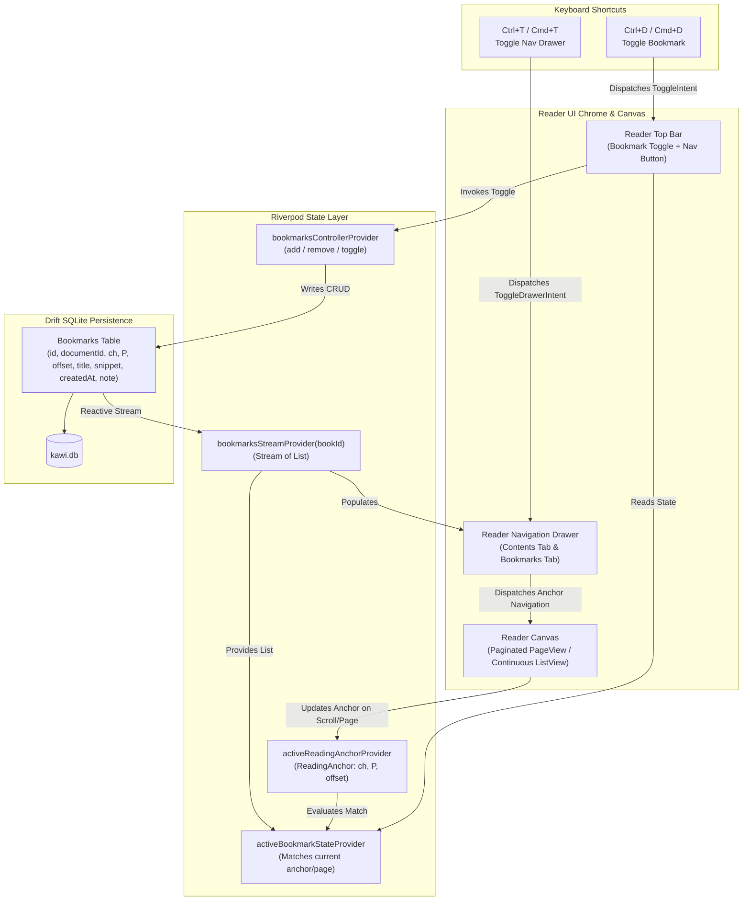
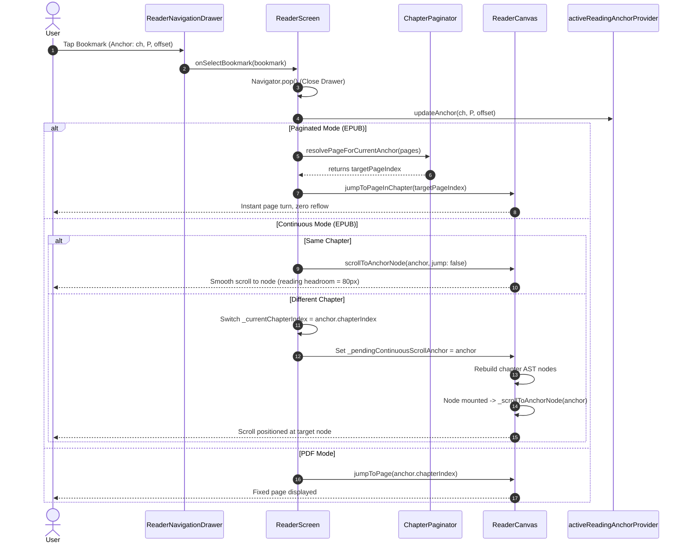

# Architectural & Implementation Plan: Persistent Bookmarks & Unified Navigation Drawer

**Document:** `bookmark_navigation_plan.md`  
**Status:** Proposed / Under Review  
**Target Milestone:** Post-Phase 6 Navigation & Reading Anchor Enhancement  
**Platforms:** Linux, macOS, Windows, Android  

---

## 1. Executive Summary & Goals

### 1.1 Objective
Build directly upon the stabilized `ReadingAnchor` architecture (`chapterIndex`, `paragraphIndex`, `charOffset`) to introduce:
1. **Persistent Bookmarks:** A Drift SQLite-backed, Riverpod-managed bookmark storage system allowing readers to save, inspect, and delete reading positions across books.
2. **Top Bar Quick Actions:** A reactive bookmark toggle icon in `ReaderScreen`'s top chrome (outline vs. filled state based on active position) with global keyboard shortcut (`Ctrl + D` / `Cmd + D`) and automated AST-based snippet extraction.
3. **Unified Navigation Drawer (Side Panel):** A tabbed side panel accessible via `Ctrl + T` / `Cmd + T` or the top bar navigation icon, combining the hierarchical Table of Contents (Contents tab) and chronological saved bookmarks (Bookmarks tab), with an extensible architecture for future user annotations.
4. **Anchor-Based Navigation Dispatch:** Clean, reflow-resilient navigation jumping for both Paginated (resolving exact `PageChunk` indices) and Continuous Scroll modes (scrolling directly to target AST node while preserving the 80px reading headroom and content insets).

### 1.2 Architectural Principles
- **Anchor Fidelity:** Bookmarks must store exact `ReadingAnchor` records rather than fragile ephemeral page numbers. If typography settings change (e.g., font size $16 \to 24$ pt or window resize), jumping to a bookmark always resolves to the exact semantic paragraph and text offset.
- **Zero-Reflow Guarantee:** Opening, closing, or navigating within the drawer must never invalidate the active reading anchor or reset reader viewports to page zero.
- **Format Parity:** Seamless operation across both EPUB (flowable AST nodes) and PDF (fixed-layout pages mapped to chapter anchors).
- **Offline & Local-First:** All bookmarks persist locally in SQLite via Drift with reactive streams, eliminating latency and ensuring privacy.

---

## 2. Architecture & Data Flow



---

## 3. Bookmark Data Model & Persistence

### 3.1 Domain Entity (`Bookmark`)
Located at `lib/features/reader/models/bookmark.dart`:

```dart
import 'package:flutter/foundation.dart';
import '../../../core/database/app_database.dart';
import 'document_models.dart';

@immutable
class Bookmark {
  const Bookmark({
    required this.id,
    required this.bookId,
    required this.anchor,
    this.chapterTitle,
    required this.snippet,
    required this.createdAt,
    this.note,
  });

  final String id;
  final String bookId;
  final ReadingAnchor anchor;
  final String? chapterTitle;
  final String snippet;
  final DateTime createdAt;
  final String? note;

  Bookmark copyWith({
    String? id,
    String? bookId,
    ReadingAnchor? anchor,
    String? chapterTitle,
    String? snippet,
    DateTime? createdAt,
    String? note,
  }) {
    return Bookmark(
      id: id ?? this.id,
      bookId: bookId ?? this.bookId,
      anchor: anchor ?? this.anchor,
      chapterTitle: chapterTitle ?? this.chapterTitle,
      snippet: snippet ?? this.snippet,
      createdAt: createdAt ?? this.createdAt,
      note: note ?? this.note,
    );
  }

  factory Bookmark.fromEntry(BookmarkEntry entry) {
    return Bookmark(
      id: entry.id,
      bookId: entry.documentId,
      anchor: ReadingAnchor(
        chapterIndex: entry.chapterIndex,
        paragraphIndex: entry.paragraphIndex,
        charOffset: entry.charOffset,
      ),
      chapterTitle: entry.chapterTitle,
      snippet: entry.snippet,
      createdAt: entry.createdAt,
      note: entry.note,
    );
  }

  Map<String, dynamic> toJson() => {
    'id': id,
    'bookId': bookId,
    'chapterIndex': anchor.chapterIndex,
    'paragraphIndex': anchor.paragraphIndex,
    'charOffset': anchor.charOffset,
    'chapterTitle': chapterTitle,
    'snippet': snippet,
    'createdAt': createdAt.toIso8601String(),
    'note': note,
  };

  factory Bookmark.fromJson(Map<String, dynamic> json) => Bookmark(
    id: json['id'] as String,
    bookId: json['bookId'] as String,
    anchor: ReadingAnchor(
      chapterIndex: json['chapterIndex'] as int,
      paragraphIndex: json['paragraphIndex'] as int,
      charOffset: json['charOffset'] as int,
    ),
    chapterTitle: json['chapterTitle'] as String?,
    snippet: json['snippet'] as String,
    createdAt: DateTime.parse(json['createdAt'] as String),
    note: json['note'] as String?,
  );

  @override
  bool operator ==(Object other) =>
      identical(this, other) ||
      other is Bookmark &&
          runtimeType == other.runtimeType &&
          id == other.id &&
          bookId == other.bookId &&
          anchor == other.anchor &&
          chapterTitle == other.chapterTitle &&
          snippet == other.snippet &&
          createdAt == other.createdAt &&
          note == other.note;

  @override
  int get hashCode => Object.hash(
        id,
        bookId,
        anchor,
        chapterTitle,
        snippet,
        createdAt,
        note,
      );
}
```

### 3.2 Drift Database Schema & Migration
Located at `lib/core/database/tables/bookmarks.dart`:

```dart
import 'package:drift/drift.dart';
import 'documents.dart';

@DataClassName('BookmarkEntry')
class Bookmarks extends Table {
  TextColumn get id => text()();
  TextColumn get documentId => text().references(Documents, #id)();
  IntColumn get chapterIndex => integer()();
  IntColumn get paragraphIndex => integer()();
  IntColumn get charOffset => integer()();
  TextColumn get chapterTitle => text().nullable()();
  TextColumn get snippet => text()();
  DateTimeColumn get createdAt => dateTime()();
  TextColumn get note => text().nullable()();

  @override
  Set<Column> get primaryKey => {id};
}
```

#### Database Schema Version Bump & Migration in `app_database.dart`:
```dart
@DriftDatabase(
  tables: [
    Documents,
    ReadingProgresses,
    Shelves,
    DocumentShelves,
    AppSettings,
    Bookmarks, // Newly added table
  ],
)
class AppDatabase extends _$AppDatabase {
  AppDatabase([QueryExecutor? e]) : super(e ?? _openConnection());

  @override
  int get schemaVersion => 3; // Bumped from 2 to 3

  @override
  MigrationStrategy get migration => MigrationStrategy(
    onCreate: (m) async {
      await m.createAll();
    },
    onUpgrade: (m, from, to) async {
      if (from < 2) {
        await m.createTable(appSettings);
        await m.addColumn(readingProgresses, readingProgresses.currentChapter);
      }
      if (from < 3) {
        await m.createTable(bookmarks);
      }
    },
  );

  // Bookmark Queries
  Stream<List<BookmarkEntry>> watchBookmarksForDocument(String documentId) {
    return (select(bookmarks)
          ..where((t) => t.documentId.equals(documentId))
          ..orderBy([
            (t) => OrderingTerm(expression: t.createdAt, mode: OrderingMode.desc),
          ]))
        .watch();
  }

  Future<List<BookmarkEntry>> getBookmarksForDocument(String documentId) {
    return (select(bookmarks)
          ..where((t) => t.documentId.equals(documentId))
          ..orderBy([
            (t) => OrderingTerm(expression: t.createdAt, mode: OrderingMode.desc),
          ]))
        .get();
  }

  Future<void> insertBookmark(BookmarksCompanion bookmark) {
    return into(bookmarks).insertOnConflictUpdate(bookmark);
  }

  Future<void> deleteBookmark(String id) {
    return (delete(bookmarks)..where((t) => t.id.equals(id))).go();
  }

  Future<void> deleteBookmarkByAnchor({
    required String documentId,
    required int chapterIndex,
    required int paragraphIndex,
    required int charOffset,
  }) {
    return (delete(bookmarks)..where(
          (t) =>
              t.documentId.equals(documentId) &
              t.chapterIndex.equals(chapterIndex) &
              t.paragraphIndex.equals(paragraphIndex) &
              t.charOffset.equals(charOffset),
        ))
        .go();
  }
}
```

### 3.3 State Management & Riverpod Providers
Located at `lib/features/reader/providers/bookmarks_provider.dart`:

```dart
import 'package:drift/drift.dart';
import 'package:flutter_riverpod/flutter_riverpod.dart';
import '../../../core/database/app_database.dart';
import '../../../core/database/database_provider.dart';
import '../models/bookmark.dart';
import '../models/document_models.dart';
import 'document_content_provider.dart';

/// Reactive stream of bookmarks for a specific document.
final bookmarksStreamProvider =
    StreamProvider.family<List<Bookmark>, String>((ref, documentId) {
  final db = ref.watch(databaseProvider);
  return db.watchBookmarksForDocument(documentId).map(
        (rows) => rows.map(Bookmark.fromEntry).toList(),
      );
});

/// Controller handling bookmark operations (toggle, add, delete).
class BookmarksController {
  BookmarksController(this._ref);
  final Ref _ref;

  AppDatabase get _db => _ref.read(databaseProvider);

  Future<String> toggleBookmark({
    required String documentId,
    required ReadingAnchor anchor,
    String? chapterTitle,
    required String snippet,
    String? note,
  }) async {
    final bookmarks = await _db.getBookmarksForDocument(documentId);
    
    // Find matching bookmark within the current paragraph / anchor
    final existing = bookmarks.where((b) =>
        b.chapterIndex == anchor.chapterIndex &&
        b.paragraphIndex == anchor.paragraphIndex).firstOrNull;

    if (existing != null) {
      await _db.deleteBookmark(existing.id);
      return 'removed';
    } else {
      final id = 'bm_${DateTime.now().millisecondsSinceEpoch}_${anchor.chapterIndex}_${anchor.paragraphIndex}';
      await _db.insertBookmark(
        BookmarksCompanion.insert(
          id: id,
          documentId: documentId,
          chapterIndex: anchor.chapterIndex,
          paragraphIndex: anchor.paragraphIndex,
          charOffset: anchor.charOffset,
          chapterTitle: Value(chapterTitle),
          snippet: snippet,
          createdAt: DateTime.now(),
          note: Value(note),
        ),
      );
      return 'added';
    }
  }

  Future<void> removeBookmark(String bookmarkId) async {
    await _db.deleteBookmark(bookmarkId);
  }
}

final bookmarksControllerProvider = Provider<BookmarksController>((ref) {
  return BookmarksController(ref);
});

/// Reactive computation detecting if the current reading anchor matches an existing bookmark.
final isCurrentAnchorBookmarkedProvider =
    Provider.family<Bookmark?, ({String documentId, ReadingAnchor? anchor, List<PageChunk>? currentPages, bool isPaginated})>((ref, params) {
  final bookmarksAsync = ref.watch(bookmarksStreamProvider(params.documentId));
  final bookmarks = bookmarksAsync.value ?? const [];
  final anchor = params.anchor;
  if (anchor == null || bookmarks.isEmpty) return null;

  if (params.isPaginated && params.currentPages != null && params.currentPages!.isNotEmpty) {
    // Paginated mode: check if any bookmark falls within the active visible PageChunk
    final activeChunk = params.currentPages!.where((chunk) =>
      chunk.chapterIndex == anchor.chapterIndex &&
      chunk.containsAnchor(
        paragraphIndex: anchor.paragraphIndex,
        charOffset: anchor.charOffset,
      )).firstOrNull;

    if (activeChunk != null) {
      return bookmarks.where((b) =>
        b.anchor.chapterIndex == activeChunk.chapterIndex &&
        activeChunk.containsAnchor(
          paragraphIndex: b.anchor.paragraphIndex,
          charOffset: b.anchor.charOffset,
        )).firstOrNull;
    }
  }

  // Continuous / fallback: match exact paragraph in current chapter
  return bookmarks.where((b) =>
      b.anchor.chapterIndex == anchor.chapterIndex &&
      b.anchor.paragraphIndex == anchor.paragraphIndex).firstOrNull;
});
```

---

## 4. Top Bar Quick Actions & Snippet Extraction

### 4.1 Top Bar Layout & Toggle Placement
In `lib/features/reader/screens/reader_screen.dart`, update `_buildTopAppBar`:
- Place the unified **Navigation Drawer Toggle** on the left:
  - Icon: `PhosphorIconsLight.sidebarSimple` or `PhosphorIconsLight.bookBookmark`
  - Tooltip: `Navigation & Bookmarks (Ctrl+T)`
  - OnPressed: `_toggleNavigationDrawer()`
- Place the **Bookmark Toggle Button** in the right action cluster, immediately preceding the Read Aloud (TTS) button:
  - Active state: `PhosphorIconsFill.bookmarkSimple` with `theme.accent` color.
  - Inactive state: `PhosphorIconsLight.bookmarkSimple` with `theme.textPrimary` color.
  - Tooltip: `activeBookmark != null ? 'Remove Bookmark (Ctrl+D)' : 'Add Bookmark (Ctrl+D)'`.

```
+------------------------------------------------------------------------------------------------------+
| [Back] [Nav Drawer (Ctrl+T)]    Document Title & Current Chapter    [Bookmark (Ctrl+D)] [TTS] [Settings] |
+------------------------------------------------------------------------------------------------------+
```

### 4.2 AST-Aware Text Snippet Extraction
When the user toggles a bookmark, a snippet is extracted automatically from AST nodes or page text to display in the drawer preview.

```dart
Future<String> _extractSnippetForAnchor(ReadingAnchor anchor) async {
  if (widget.document.isEpub) {
    try {
      final nodes = await ref.read(documentChapterNodesProvider((
        filePath: widget.document.filePath,
        chapterIndex: anchor.chapterIndex,
      )).future);

      if (anchor.paragraphIndex >= 0 && anchor.paragraphIndex < nodes.length) {
        final node = nodes[anchor.paragraphIndex];
        String fullText = '';
        if (node is ParagraphNode) {
          fullText = node.plainText;
        } else if (node is HeadingNode) {
          fullText = node.plainText;
        }

        if (fullText.trim().isNotEmpty) {
          String rawSlice = fullText;
          if (anchor.charOffset > 0 && anchor.charOffset < fullText.length) {
            rawSlice = fullText.substring(anchor.charOffset);
          }
          final clean = rawSlice.replaceAll(RegExp(r'\s+'), ' ').trim();
          if (clean.length > 120) {
            return '${clean.substring(0, 117)}...';
          }
          return clean;
        }
      }
    } catch (_) {
      // Fallback below
    }
  }

  // Fallback for PDF or unloaded EPUB nodes
  final firstSnippet = _canvasKey.currentState?.getFirstVisibleTextSnippet();
  if (firstSnippet != null && firstSnippet.trim().isNotEmpty) {
    final clean = firstSnippet.replaceAll(RegExp(r'\s+'), ' ').trim();
    return clean.length > 120 ? '${clean.substring(0, 117)}...' : clean;
  }

  return 'Bookmark at chapter ${anchor.chapterIndex + 1}';
}
```

### 4.3 Global Keyboard Shortcuts
Add Intents and Shortcut mappings to `ReaderScreen`:

```dart
/// Intent to toggle/add a bookmark at the current active anchor.
class ToggleBookmarkIntent extends Intent {
  const ToggleBookmarkIntent();
}

/// Intent to open/close the navigation drawer.
class ToggleNavigationDrawerIntent extends Intent {
  const ToggleNavigationDrawerIntent();
}
```

#### Shortcuts Mapping:
```dart
// Bookmarks toggle: Ctrl+D on Windows/Linux, Cmd+D on macOS
const SingleActivator(LogicalKeyboardKey.keyD, control: true):
    const ToggleBookmarkIntent(),
const SingleActivator(LogicalKeyboardKey.keyD, meta: true):
    const ToggleBookmarkIntent(),

// Navigation drawer toggle: Ctrl+T on Windows/Linux, Cmd+T on macOS
const SingleActivator(LogicalKeyboardKey.keyT, control: true):
    const ToggleNavigationDrawerIntent(),
const SingleActivator(LogicalKeyboardKey.keyT, meta: true):
    const ToggleNavigationDrawerIntent(),
```

#### Actions Execution:
```dart
Future<void> _toggleBookmark() async {
  final currentAnchor = ref.read(activeReadingAnchorProvider);
  if (currentAnchor == null) return;

  final snippet = await _extractSnippetForAnchor(currentAnchor);
  final result = await ref.read(bookmarksControllerProvider).toggleBookmark(
        documentId: widget.document.id,
        anchor: currentAnchor,
        chapterTitle: _currentChapterTitle,
        snippet: snippet,
      );

  if (mounted) {
    ScaffoldMessenger.of(context).hideCurrentSnackBar();
    ScaffoldMessenger.of(context).showSnackBar(
      SnackBar(
        content: Text(
          result == 'added' ? 'Bookmark added' : 'Bookmark removed',
          style: AppTypography.bodySmall,
        ),
        duration: const Duration(milliseconds: 1500),
        behavior: SnackBarBehavior.floating,
        width: 220,
      ),
    );
  }
}

void _toggleNavigationDrawer() {
  if (_scaffoldKey.currentState?.isDrawerOpen == true) {
    Navigator.of(context).pop();
  } else {
    _scaffoldKey.currentState?.openDrawer();
  }
}
```

---

## 5. Unified Navigation Drawer (Side Panel)

### 5.1 Component Structure
Evolve `lib/features/reader/widgets/toc_drawer.dart` into `lib/features/reader/widgets/reader_navigation_drawer.dart`:
- Retain backward compatibility by aliasing `typedef TocDrawer = ReaderNavigationDrawer;`.
- Fixed width on desktop: 360px.
- Background: `theme.bgCard`.
- Surface: Clean divider borders using `theme.borderSubtle`.

```
+-------------------------------------------------------------+
| [Contents (TOC)]          [Bookmarks (N)]               [X] |
+-------------------------------------------------------------+
| Filter input / Search bar (Active on Contents tab)          |
+-------------------------------------------------------------+
| Scrollable Body:                                            |
|   Tab 1: Hierarchical Chapter Outline with Active Indicator |
|   Tab 2: Chronological Bookmarks List with Snippet & Delete |
|   Tab 3: (Future-proofed) Notes & Highlights                |
+-------------------------------------------------------------+
```

### 5.2 Future-Proof Tab Model
```dart
enum NavigationDrawerTab {
  contents,
  bookmarks,
  annotations; // Reserved for Phase 8

  String get label {
    switch (this) {
      case NavigationDrawerTab.contents:
        return 'Contents';
      case NavigationDrawerTab.bookmarks:
        return 'Bookmarks';
      case NavigationDrawerTab.annotations:
        return 'Notes & Highlights';
    }
  }

  PhosphorIconData get icon {
    switch (this) {
      case NavigationDrawerTab.contents:
        return PhosphorIconsLight.listBullets;
      case NavigationDrawerTab.bookmarks:
        return PhosphorIconsLight.bookmarkSimple;
      case NavigationDrawerTab.annotations:
        return PhosphorIconsLight.highlighterCircle;
    }
  }
}
```

### 5.3 Tab 1: Contents (TOC Tree)
- Maintains full support for nested EPUB navPoints and PDF outlines via `DocumentExtractor.extractTableOfContents`.
- Real-time search/filter TextField with instant query matching.
- Highlights active chapter row with `theme.accent.withValues(alpha: 0.12)` background and 3px left accent border.
- Displays page number badges if paginated mode is active.
- Tapping a TOC chapter dispatches navigation and closes the drawer.

### 5.4 Tab 2: Bookmarks List
- Real-time reactive stream via `bookmarksStreamProvider(documentId)`.
- **Empty State:** Centered `PhosphorIconsLight.bookmarkSimple` icon, headline "No Bookmarks Yet", and caption "Press Ctrl+D or tap the bookmark icon in the top bar to save your position."
- **Bookmark Card Item:**
  - Chapter title header (`Literata` / `Inter`, bold, 13pt).
  - Snippet preview (italicized, muted text, max 2 lines with ellipsis).
  - Creation date formatted (e.g., `Oct 27, 2026 • 10:45 PM`).
  - Delete action button: subtle trash icon (`PhosphorIconsLight.trash`), calls `bookmarksController.removeBookmark(bookmark.id)`.
  - Tapping anywhere on the card dispatches clean navigation to `bookmark.anchor` and closes the drawer.

---

## 6. Anchor-Based Navigation Dispatch Pipeline



### 6.1 Dispatch in Paginated Mode
When a bookmark is selected in Paginated Mode:
1. If the bookmark is in a different chapter:
   - Set `_currentChapterIndex = bookmark.anchor.chapterIndex`.
   - The provider `chapterPagesProvider` resolves the layout `List<PageChunk>` for the target chapter.
   - Target page is resolved via `ChapterPaginator.findPageForAnchor(pages: pages, paragraphIndex: anchor.paragraphIndex, charOffset: anchor.charOffset)`.
   - Invoke `_canvasKey.currentState?.jumpToPageInChapter(targetPage)`.
2. If in the same chapter:
   - Target page is resolved immediately from `_currentChapterPages`.
   - Invoke `_canvasKey.currentState?.jumpToPageInChapter(targetPage)`.
3. Update `activeReadingAnchorProvider.notifier.updateAnchor(...)`.
4. Trigger debounced reading progress persistence.

### 6.2 Dispatch in Continuous Mode & 80px Headroom
When a bookmark is selected in Continuous Scroll Mode:
1. Expose public helper on `ReaderCanvasState`:
   ```dart
   void navigateToAnchor(ReadingAnchor anchor) {
     if (_currentChapterIndex == anchor.chapterIndex) {
       _scrollToAnchorNode(anchor, jump: false);
     } else {
       setState(() {
         _currentChapterIndex = anchor.chapterIndex;
         _pendingContinuousScrollAnchor = anchor;
         _isProgrammaticReanchoring = true;
       });
     }
   }
   ```
2. The method `_scrollToAnchorNode` computes coordinates relative to `scrollableBox` and maintains the **80px reading headroom**:
   ```dart
   const readingLine = 80.0;
   final scrollDelta = nodeDy - readingLine;
   final targetOffset = (scrollable.position.pixels + scrollDelta).clamp(
     scrollable.position.minScrollExtent,
     scrollable.position.maxScrollExtent,
   );
   ```
3. Content insets (horizontal margins, status bar headroom) are automatically preserved because `nodeDy` is resolved from `scrollableBox.globalToLocal(box.localToGlobal(Offset.zero))`.

---

## 7. Proposed Code Changes & File Demarcation

### 7.1 Domain & Database Layer
- `[NEW]` `lib/features/reader/models/bookmark.dart`: Domain entity, JSON serialization, and Drift entity conversion.
- `[NEW]` `lib/core/database/tables/bookmarks.dart`: Drift table definition for SQLite persistence.
- `[MODIFY]` `lib/core/database/app_database.dart`: Register `Bookmarks` table, bump `schemaVersion` to 3, migration step `from < 3`, and CRUD queries.
- `[GENERATE]` `lib/core/database/app_database.g.dart`: Run `dart run build_runner build --delete-conflicting-outputs`.

### 7.2 State & Provider Layer
- `[NEW]` `lib/features/reader/providers/bookmarks_provider.dart`: `bookmarksStreamProvider`, `bookmarksControllerProvider`, and `isCurrentAnchorBookmarkedProvider`.
- `[MODIFY]` `lib/features/reader/providers/document_content_provider.dart`: Ensure `ReadingAnchor` has clean equality, hashing, and copy methods.

### 7.3 UI & Drawer Layer
- `[NEW]` `lib/features/reader/widgets/reader_navigation_drawer.dart`: Unified tabbed drawer with Contents and Bookmarks tabs.
- `[MODIFY]` `lib/features/reader/widgets/toc_drawer.dart`: Alias `TocDrawer` to `ReaderNavigationDrawer` to preserve existing imports and tests.
- `[MODIFY]` `lib/features/reader/widgets/reader_canvas.dart`: Expose `navigateToAnchor(ReadingAnchor anchor)` and `scrollToAnchorNode` on `ReaderCanvasState`.
- `[MODIFY]` `lib/features/reader/screens/reader_screen.dart`:
  - Add `ToggleBookmarkIntent` and `ToggleNavigationDrawerIntent`.
  - Add shortcuts `Ctrl+D` / `Cmd+D` and `Ctrl+T` / `Cmd+T`.
  - Add Bookmark toggle button and update Navigation Drawer button in `_buildTopAppBar`.
  - Implement `_toggleBookmark()`, `_extractSnippetForAnchor()`, and anchor navigation handler.

---

## 8. Verification & Test Plan

### 8.1 Automated Test Suites

| Test File | Target Coverage | Key Assertions |
|---|---|---|
| `test/features/reader/bookmark_model_test.dart` `[NEW]` | Domain & Serialization | `Bookmark.toJson()`, `fromJson()`, `fromEntry()`, equality, hash codes, and anchor immutability. |
| `test/core/database/bookmarks_database_test.dart` `[NEW]` | Database CRUD & Migration | SQLite insertion, schema v3 upgrade, `watchBookmarksForDocument` reactivity, cascading deletion on document removal. |
| `test/features/reader/bookmarks_provider_test.dart` `[NEW]` | Riverpod State & Notifiers | Toggle add/remove transitions, active bookmark detection across paginated chunks and continuous scroll. |
| `test/features/reader/reader_navigation_drawer_test.dart` `[NEW]` | Widget & Drawer Interaction | Tab switching between Contents and Bookmarks, empty state rendering, bookmark deletion, and tap-to-navigate callbacks. |
| `test/features/reader/bookmark_shortcuts_and_actions_test.dart` `[NEW]` | Shortcuts & Top Bar Actions | `Ctrl+D` adds/removes bookmark with toast feedback, `Ctrl+T` opens/closes drawer, outline vs. filled icon synchronization. |
| `test/features/reader/reading_anchor_stability_test.dart` `[MODIFY]` | Zero-Reflow Guarantee | Verify that jumping to a bookmark and opening/closing the drawer retains position across typography changes. |

### 8.2 Execution Commands
```bash
# 1. Generate updated Drift SQLite code
dart run build_runner build --delete-conflicting-outputs

# 2. Run static analysis
flutter analyze

# 3. Execute unit and widget test suites
flutter test test/features/reader/bookmark_model_test.dart
flutter test test/core/database/bookmarks_database_test.dart
flutter test test/features/reader/bookmarks_provider_test.dart
flutter test test/features/reader/reader_navigation_drawer_test.dart
flutter test test/features/reader/bookmark_shortcuts_and_actions_test.dart
flutter test test/features/reader/reading_anchor_stability_test.dart
```

### 8.3 Manual Verification Checklist
1. **Bookmark Creation:**
   - Navigate to any paragraph in an EPUB book (Paginated mode). Tap the Bookmark icon in the top chrome or press `Ctrl + D`.
   - Verify outline icon changes to filled accent icon, and brief toast "Bookmark added" appears.
2. **Drawer Inspection:**
   - Press `Ctrl + T` or tap the Navigation Drawer icon.
   - Switch to the "Bookmarks" tab.
   - Verify the newly created bookmark is displayed with correct chapter title, text snippet preview, and timestamp.
3. **Anchor Navigation:**
   - Turn forward 5 pages. Open drawer, tap the saved bookmark.
   - Verify view turns back immediately to the exact bookmarked page and sentence.
4. **Continuous Mode Jump:**
   - Switch to Continuous Scroll mode.
   - Scroll down several chapters. Open drawer and tap the bookmark.
   - Verify smooth scroll directly to the bookmarked paragraph, cleanly positioned 80px below the top headroom.
5. **Zero-Reflow Verification:**
   - With bookmark active, change font size from 16 to 22.
   - Verify the viewport stays anchored on the exact bookmarked sentence without resetting to page 1.
6. **Deletion:**
   - Tap the trash icon in the drawer or press `Ctrl + D` on the bookmarked page.
   - Verify bookmark is deleted, icon reverts to outline, and drawer list updates reactively.
